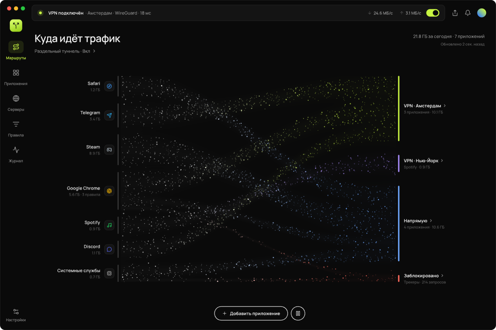
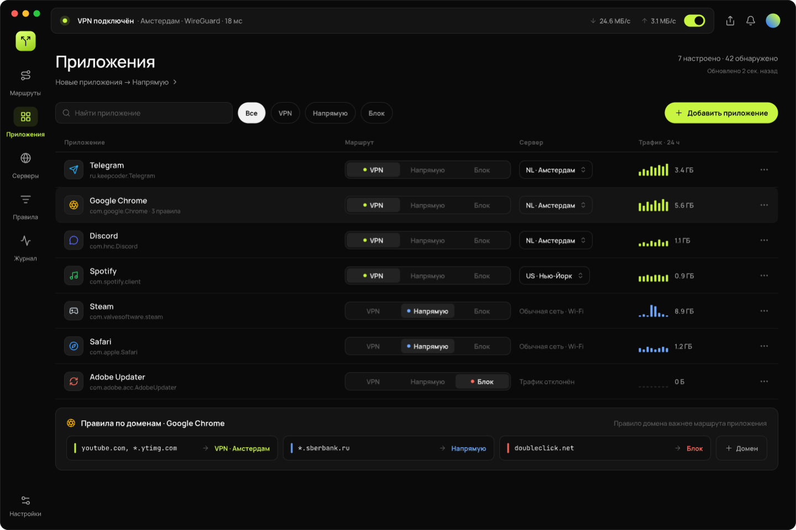
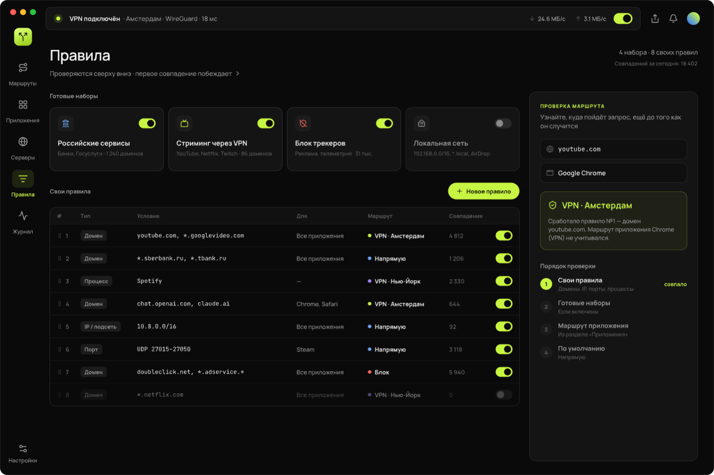
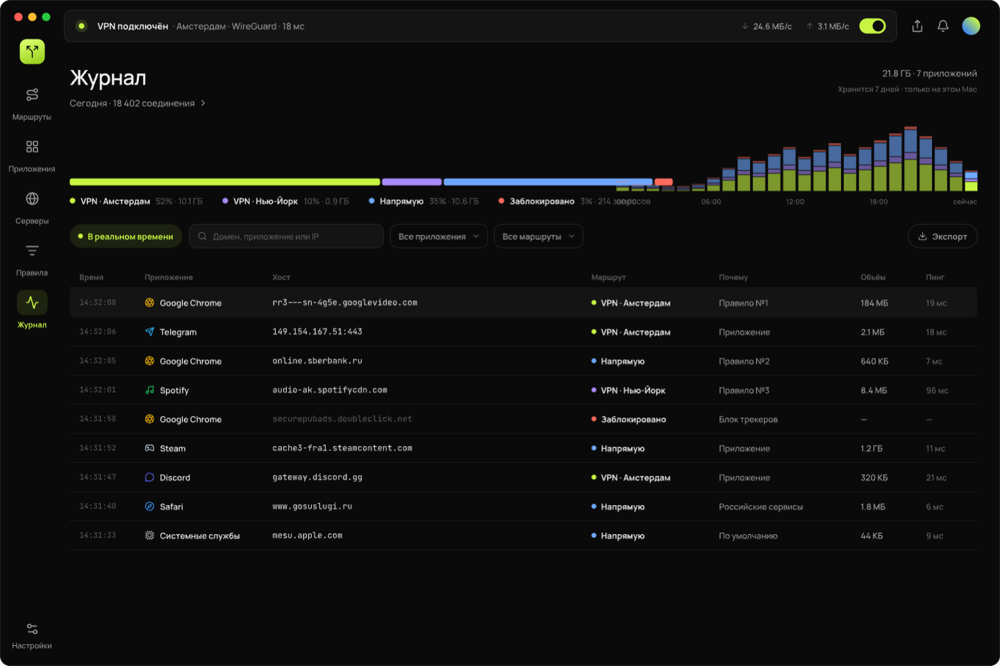

<p align="center"></p>

<h1 align="center">Splitroute</h1>
<p align="center">Per-app split tunneling for macOS — every app takes its own path.</p>
<p align="center"><a href="https://github.com/Tolib-N8/Splitroute/releases/latest"><b>Download the latest version</b></a> · <a href="README.ru.md">Русский</a></p>



Some apps only work through a VPN, others only without one. Splitroute ends the constant switching:
WhatsApp, Chrome and Claude go through the VPN while WeChat and banking apps go direct — **at the same time**.

## Features

- **An exit for every app:** an already connected VPN app (ZoogVPN, AIRLINK…), your own config
  (VLESS/Reality, Shadowsocks, Trojan, Hysteria2, WireGuard `.conf`, OpenVPN `.ovpn`, subscriptions), direct, or blocked.
- **Fallback VPN:** if the VPN an app is assigned to disconnects, its traffic moves to another connected VPN
  instead of being blocked. Pick a specific fallback per exit, or let Splitroute use any available VPN.
- **Auto-connect:** Splitroute can turn a VPN app on by itself when apps need it, retrying less and less often if it fails.
- **“Not reachable directly” suggestions:** Splitroute notices programs and sites whose direct connections die
  without a single byte — a typical sign of blocking — and offers to route them through a VPN in one click.
- **Scenarios:** separate route sets for home, office or travel. Switch them from the top bar or the menu bar,
  or bind one to a network so it turns on by itself.
- **Notifications** when a VPN drops or comes back (and where its apps went), when something looks blocked,
  and when a scenario switches.
- **Command-line programs** (Claude Code, Codex CLI…): the rule is set on the folder, so it survives updates.
- **Domain, IP and port rules** plus ready-made sets: “Chinese services → direct”, “Blocked in China → VPN”, ad blocking.
  Order: your rules → sets → app route → default.
- **DNS without ISP tampering:** while the core runs it becomes the system DNS; names resolve through the VPN,
  Chinese and local domains go direct.
- **Kill switch:** if a VPN disconnects and there is no fallback, its apps are blocked instead of leaking directly.
- **Journal** of connections with the reason for each route, live traffic flows, menu bar icon, hotkeys ⌥⌘V / ⌥⌘J / ⌥⌘R.
- **English and Russian interface.**
- **Automatic updates** from GitHub Releases, verified with an Ed25519 signature.

| Apps | Rules | Journal |
|---|---|---|
|  |  |  |

## Installation

1. Download `Splitroute-x.y.z.dmg` from [Releases](https://github.com/Tolib-N8/Splitroute/releases/latest) and drag Splitroute to Applications.
2. The app is not signed with an Apple Developer ID, so macOS blocks it on first launch:
   **System Settings → Privacy & Security → “Open Anyway”**. Or in Terminal:
   ```sh
   xattr -dr com.apple.quarantine /Applications/Splitroute.app
   ```
3. Follow the welcome screens: install the system component (the administrator password is needed once) and pick your apps.

Requirements: macOS 15+, Apple Silicon.

To remove the system component: **Settings → Remove system component…** or
`sudo /Library/PrivilegedHelperTools/com.splitroute/splitroute-helper uninstall`.

## How it works

- The core is [sing-box](https://sing-box.sagernet.org) 1.14 in TUN mode, run as root by a launchd daemon.
- Apps are matched with `process_path_regex` on the bundle path, including their helper processes.
- A “VPN app” exit is a `direct` outbound with `bind_interface` set to that VPN's utun; “Direct” binds to Wi‑Fi/Ethernet.
- The root helper accepts only the user's profile and builds the sing-box config itself — an arbitrary config cannot be passed in.
- The core's DNS is published as a temporary SCDynamicStore key: if the core stops or crashes, macOS restores the previous DNS by itself.
- Tailscale and local networks are left alone.

## Building

```sh
sh scripts/bundle.sh           # build/Splitroute.app (downloads and verifies sing-box)
swift test                     # model, config generator (+ sing-box check), rules, fallback, scenarios
sh scripts/strings.sh          # lists interface strings missing an English translation
sh scripts/e2e.sh "AIRLINK VPN"   # live check after installing the component
sh scripts/support.sh          # donation links from support.json → README, FUNDING.yml, app (PUBLISH=1)
```

## Limitations

- Safari and other WebKit apps go online through a shared system process, so they cannot be split across exits.
  Use domain rules for them instead.
- Connecting and changing servers is done in the VPN app itself.
- Rejected and very short connections may not appear in the journal.

<!-- support:start -->
<!-- support:end -->

## License

Splitroute is free and open source under the [MIT License](LICENSE).

Third-party components keep their own licenses — see [THIRD_PARTY_NOTICES.md](THIRD_PARTY_NOTICES.md).
